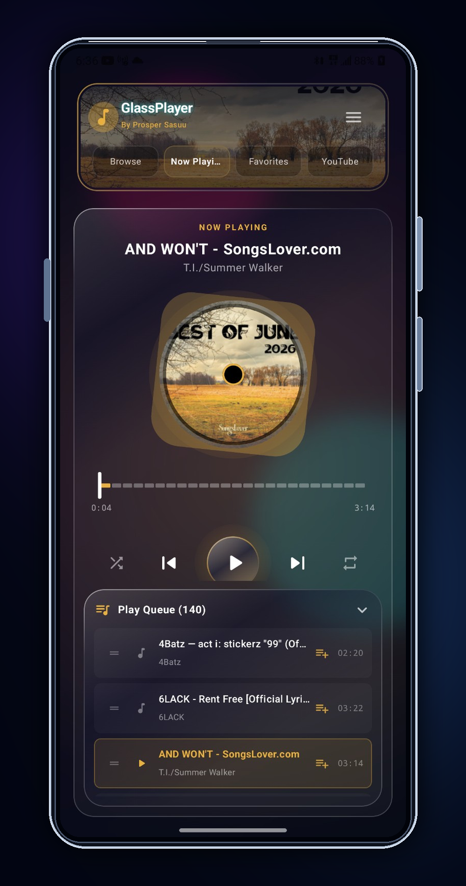
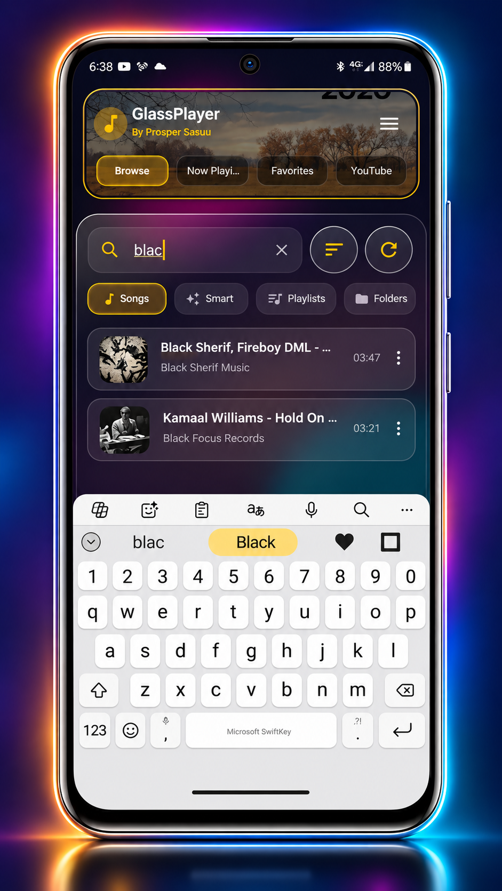

# 🎵 GlassPlayer 2.0.1

### A modern, glassmorphism-inspired Android music player built with Jetpack Compose.

GlassPlayer is a feature-rich, high-performance Android music player designed to provide a clean, modern, and audiophile-grade listening experience for both local media files and online streaming.

---

## ✨ Key Features

- **🎧 HD Sound Quality Engine**: 32-bit Floating Point PCM audio output built on **Android Media3 ExoPlayer**. Preserves high dynamic range, eliminates quantization noise, and supports high-resolution lossless audio formats (FLAC, ALAC, WAV, AAC, Opus, OGG).
- **⚡ Ultra-Fast Playback & Caching**: Optimized low-latency playback initialization with built-in **100MB LRU Disk Media Cache** (`SimpleCache` + `CacheDataSource`). Streamed tracks load instantly from disk on replay or seek with zero network delay.
- **🌐 YouTube & YouTube Music Integration**: Seamless in-app streaming, high-bitrate audio stream selection (Opus 160kbps+, AAC 256kbps+), YouTube playlist importing, and continuation pagination.
- **🔄 Seamless Mixed Queue Transition**: Intelligent auto-advance that smoothly transitions between online streams and local device tracks without pausing.
- **🎨 Glassmorphic Interface**: Translucent glass cards, frosted blur reflections, and dynamic color palettes adapting to album artwork.
- **📁 Local Music Library & Folders**: Automatic scanning of local device storage with folder blacklist management and metadata extraction.
- **📂 Smart Playlists**: Browse by Songs, Albums, Artists, Playlists, and Folders, plus Smart Playlists (*Recently Added*, *Most Played*, *Never Played*, *Long Tracks*, *Released This Year*).
- **📝 Synced Lyrics**: Real-time LRC lyrics synchronization powered by `LrcLibService`.
- **🎚️ Equalizer & ReplayGain**: Built-in multi-band equalizer, per-track ReplayGain offset normalization, and gradual fade-out sleep timer.
- **🚗 Driving Mode & Android Auto**: Simplified large touch-target driving UI and Android Auto car head unit support.
- **📱 Widgets & Last.fm**: Home screen app widgets and Last.fm scrobbling integration.

---

## 📱 Screenshots

### Home Screen & Now Playing
| Home Screen | Now Playing |
| :---: | :---: |
|  |  |

### Playlists, Search & Folders
| Playlist | Search | Folder |
| :---: | :---: | :---: |
|  |  |  |

### YouTube Music Integration
| YouTube Music | Search & Streaming | Playlist Link Detected | Now Playing (Online) |
| :---: | :---: | :---: | :---: |
|  |  |  |  |

---

## 🏗️ Architecture & Core Components

GlassPlayer follows modern Android development best practices, implementing Clean Architecture principles and reactive state management using Jetpack Compose and Kotlin Coroutines/Flow.

### 🏛️ Key Source Files (`com.example`)
- **[PlayerEngine.kt](app/src/main/java/com/example/PlayerEngine.kt)**: Core audio playback controller built on Android Media3 ExoPlayer, managing media sessions, audio focus, caching, and equalizer settings.
- **[AudioRepository.kt](app/src/main/java/com/example/AudioRepository.kt)**: Unified repository coordinating local media store scans, Room database operations, and metadata extraction.
- **[AudioViewModel.kt](app/src/main/java/com/example/AudioViewModel.kt)**: Main ViewModel handling UI state flows, queue management, playlist interactions, and playback actions.
- **[OnlineMusicService.kt](app/src/main/java/com/example/OnlineMusicService.kt)** & **[YouTubeMusicPlayer.kt](app/src/main/java/com/example/YouTubeMusicPlayer.kt)**: Integration layers for fetching streams, parsing YouTube Music playlists, and handling network playback.
- **[PlaybackService.kt](app/src/main/java/com/example/PlaybackService.kt)**: Foreground MediaLibraryService ensuring uninterrupted background playback and media notification controls.
- **[GlassPlayerScreen.kt](app/src/main/java/com/example/GlassPlayerScreen.kt)**: Comprehensive Jetpack Compose UI implementation featuring glassmorphic design elements, navigation tabs, and playback controls.
- **[GlassAutoService.kt](app/src/main/java/com/example/GlassAutoService.kt)**: Android Auto MediaLibraryService supporting safe in-car media browsing and playback.
- **[AppWidgetProvider.kt](app/src/main/java/com/example/AppWidgetProvider.kt)**: Home screen widget provider displaying current track info and playback controls.

---

## 🛠️ Tech Stack

- **UI**: Jetpack Compose, Material 3, Custom Glassmorphic Modifiers & Blur Effects
- **Playback**: Android Media3 ExoPlayer 1.5.1, MediaSession
- **Database & Storage**: Room, DataStore Preferences
- **Network & Parsing**: Kotlin Coroutines, Flow, OkHttp / Ktor / Innertube Parser
- **Testing**: JUnit, Robolectric, Compose Screenshot Tests

---

## 📋 Requirements

- Android device or emulator running **Android 8.0+ (API level 26+)**
- Android Studio Ladybug or newer
- JDK 17 / 21 compatible with Gradle setup

---

## 🚀 Build & Run From Source

Clone the repository:

```bash
git clone https://github.com/Ccroxx1/Glassplayer-By-Prosper-Sasuu.git
cd Glassplayer-By-Prosper-Sasuu
```

Open the project in Android Studio or build via Gradle:

```bash
./gradlew assembleDebug
```

---

## 🧪 Testing

Run unit and Robolectric tests:

```bash
./gradlew testDebugUnitTest
```

---

## 📄 License

GlassPlayer is open-source software.
